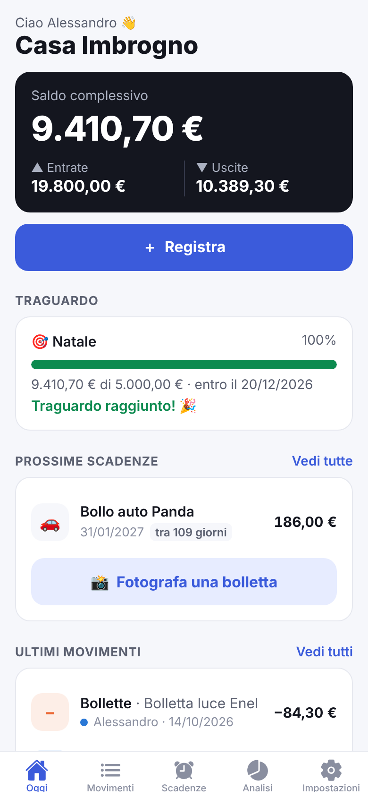
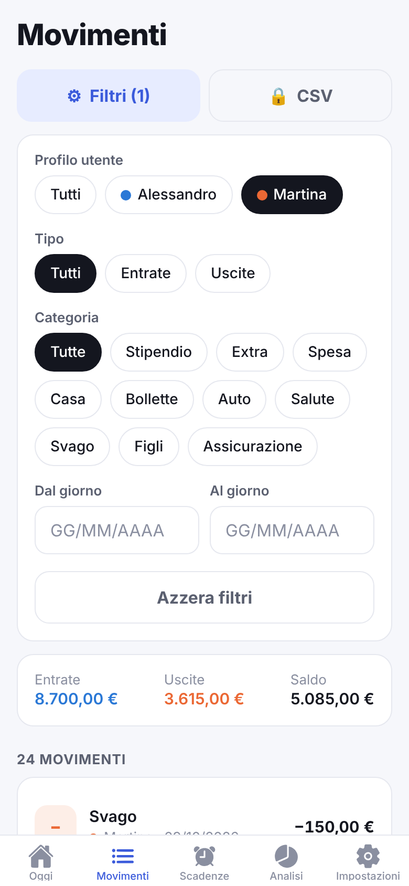
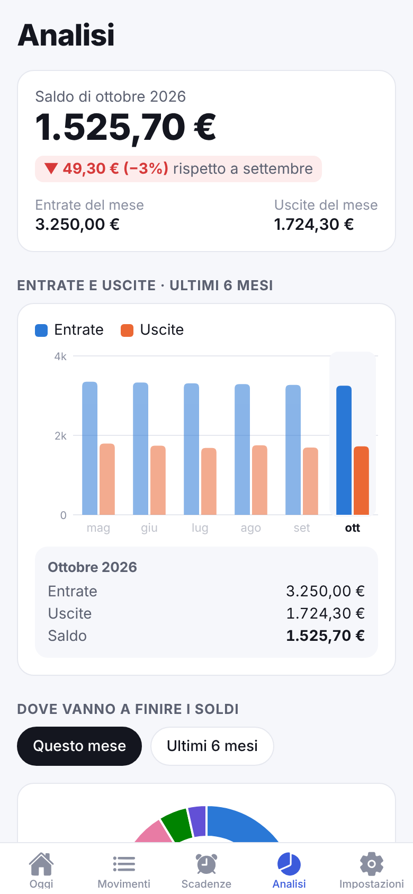

# 🏡 Casa in Ordine

**I soldi e le scadenze della famiglia, in un'unica app condivisa.**
App per iPhone e Android (React Native + Expo) con cassa familiare, scadenze lette dall'IA e abbonamento Premium.

| Oggi | Movimenti | Scadenze | Analisi |
|---|---|---|---|
|  |  |  |  |

Strategia, analisi di mercato e piano di lancio: [`docs/STRATEGIA.md`](docs/STRATEGIA.md).

## Funzioni

- **Oggi**: saldo complessivo, totale entrate e uscite, pulsante *Registra*, traguardo di risparmio con
  barra di avanzamento e quota mensile necessaria, prossime scadenze, ultimi movimenti.
- **Registra**: entrata/uscita, importo, categoria, utente che registra, data, note.
- **Movimenti**: filtri per utente, categoria, tipo, dal giorno A al giorno B; totali filtrati; export **CSV** (Premium).
- **Scadenze**: foto di bollette, multe, bollo, F24, lettere → l'IA estrae importo e scadenza e spiega
  "cosa dice" e "cosa fare"; promemoria 3 giorni prima e il giorno stesso; "Segna pagata" registra l'uscita in cassa.
- **Analisi**: saldo del mese, variazione rispetto al mese precedente, grafico entrate/uscite degli ultimi 6 mesi,
  grafico a ciambella delle spese per categoria.
- **Impostazioni**: obiettivo di risparmio condiviso (nome, importo, data), categorie (aggiungi, attiva/disattiva),
  membri della famiglia, codice invito, abbonamento.
- **Famiglia condivisa**: più persone nello stesso gruppo con un codice di 6 caratteri, aggiornamenti in tempo reale.

## Modello di guadagno

| | Gratis | Premium (3,99 €/mese o 24,99 €/anno, 7 giorni di prova) |
|---|---|---|
| Cassa, analisi, obiettivo, famiglia | ✅ | ✅ |
| Scansioni IA | 3 al mese | Illimitate |
| Export CSV | — | ✅ |

Un abbonamento vale per **tutta la famiglia**. Le soglie si cambiano in `src/lib/config.ts`
(e `FREE_SCANS_PER_MONTH` nella Edge Function).

## Architettura

```
src/app/            schermate (Expo Router): (tabs)/ index, movimenti, scadenze, analisi, impostazioni
                    + onboarding, registra, scadenza, premium (modali)
src/lib/            store, backend (locale / Supabase), notifiche, CSV, abbonamenti, formati
src/components/     UI e grafici (react-native-svg)
supabase/           schema SQL con Row Level Security + Edge Functions
  functions/scan-document      lettura documenti con Claude (vision + output strutturato)
  functions/revenuecat-webhook attiva Premium per il gruppo
```

- **Senza configurazione** l'app parte in *modalità locale*: dati solo sul telefono, niente IA né inviti.
  Utile per provarla subito.
- **Con Supabase**: login anonimo automatico (nessuna registrazione), dati condivisi e protetti per gruppo.

## Provarla subito

```bash
npm install
npx expo start        # poi apri con l'app "Expo Go" sul telefono (QR code), oppure premi "w" per il browser
```

Gli abbonamenti (RevenueCat) richiedono una *development build*: `npx eas-cli@latest build --profile development`.

## Messa in produzione, passo per passo

### 1. Supabase (database + IA) — gratis per iniziare
1. Crea un progetto su [supabase.com](https://supabase.com).
2. **Authentication → Sign In / Providers → Anonymous sign-ins**: attiva.
3. **SQL Editor**: incolla ed esegui `supabase/migrations/0001_init.sql`.
4. Installa la CLI e collega il progetto:
   ```bash
   npx supabase login
   npx supabase link --project-ref <ID-PROGETTO>
   npx supabase secrets set ANTHROPIC_API_KEY=sk-ant-...      # da console.anthropic.com
   npx supabase functions deploy scan-document
   npx supabase secrets set REVENUECAT_WEBHOOK_SECRET=<una-password-lunga-a-caso>
   npx supabase functions deploy revenuecat-webhook --no-verify-jwt
   ```
5. Copia `.env.example` in `.env` e inserisci URL e *anon key* (Project Settings → API).

Costo IA: ogni scansione usa Claude Haiku 5.5, il modello più economico (circa 0,1 centesimi a scansione,
cioè ~1 € ogni 1.000 scansioni). Se servisse più precisione sui documenti difficili si può passare a
`claude-opus-5-5` (circa 2-3 centesimi) in `supabase/functions/scan-document/index.ts`.

### 2. Account sviluppatore
- Apple Developer Program: 99 $/anno — [developer.apple.com](https://developer.apple.com/programs/)
- Google Play Console: 25 $ una tantum — [play.google.com/console](https://play.google.com/console)

### 3. Abbonamenti (RevenueCat — ha un piano gratuito per iniziare, verifica le condizioni attuali)
1. Crea i prodotti negli store: `premium_mensile` (3,99 €) e `premium_annuale` (24,99 € con 7 giorni di prova).
2. Su [revenuecat.com](https://www.revenuecat.com): crea il progetto, collega App Store e Play Store,
   crea l'entitlement **`premium`** e un'offering *default* con i pacchetti *Monthly* e *Annual*.
3. Copia le chiavi pubbliche iOS/Android nel `.env`.
4. **Integrations → Webhooks**: URL `https://<ID-PROGETTO>.supabase.co/functions/v1/revenuecat-webhook`,
   *Authorization header* = il valore di `REVENUECAT_WEBHOOK_SECRET`.

### 4. Build e pubblicazione (senza Mac, con EAS)
```bash
npx eas-cli@latest login
npx eas-cli@latest build --platform all --profile production
npx eas-cli@latest submit --platform ios
npx eas-cli@latest submit --platform android
```
Prima della pubblicazione:
- sostituisci le icone in `assets/` (1024×1024) e, se vuoi, il nome in `app.json`
  (`it.casainordine.app` è l'identificativo: cambialo con un dominio tuo);
- pubblica una **privacy policy** (obbligatoria: l'app tratta dati finanziari e foto di documenti) e indicala negli store;
- nelle schede degli store dichiara: dati finanziari, foto (solo su azione dell'utente), identificativo utente.

## Comandi utili

```bash
npm run typecheck     # controllo dei tipi
npm run lint          # controllo qualità
npx expo export --platform web   # build web di prova
```
